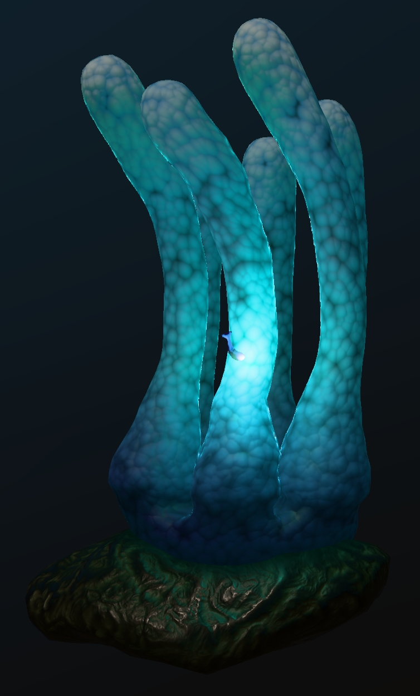

# ScatterAnemone

<!-- This file is auto-generated by modelmetadata. Do not edit by hand. -->

## Tags

[showcase](../Models-showcase.md), [extension](../Models-extension.md)

## Extensions Required

* KHR_materials_transmission
* KHR_materials_volume
* KHR_texture_transform
* KHR_lights_punctual

## Extensions Used

* KHR_materials_transmission
* KHR_materials_volume
* KHR_texture_transform
* KHR_lights_punctual
* KHR_materials_scatter

## Summary

Animated waving anemone with glowing fish, demonstrating the KHR_materials_scatter extension.

## Operations

* [Display](https://github.khronos.org/glTF-Sample-Viewer-Release/?model=https://raw.githubusercontent.com/KhronosGroup/glTF-Sample-Assets/main/./Models/ScatterAnemone/glTF-Binary/ScatterAnemone.glb) in SampleViewer
* [Download GLB](https://raw.githubusercontent.com/KhronosGroup/glTF-Sample-Assets/main/./Models/ScatterAnemone/glTF-Binary/ScatterAnemone.glb)
* [Model Directory](./)

## Screenshot

 _Screenshot from [glTF Sample Viewer](https://github.khronos.org/glTF-Sample-Viewer-Release/)._

## Description

This asset demonstrates the use of [KHR_materials_scatter](https://github.com/KhronosGroup/glTF/tree/main/extensions) to represent an anemone with volumetric light transmission.

An animated fish swims in a loop through the arms of the anemone, with an emissive texture and a point light.

The point light was added slightly in front of the fish mesh, instead of inside, because rendering with a pathtracer would cause the fish body to exclude the light.

An animated chase camera was added behind the fish. Another camera was added at the base of the anemone, looking upwards.

## Legal

&copy; 2026, Eric Chadwick. [Creative Commons Attribution 4.0 International](https://creativecommons.org/licenses/by/4.0/legalcode)

 - Eric Chadwick for Everything

<!-- This file is auto-generated by modelmetadata. Do not edit by hand. -->
