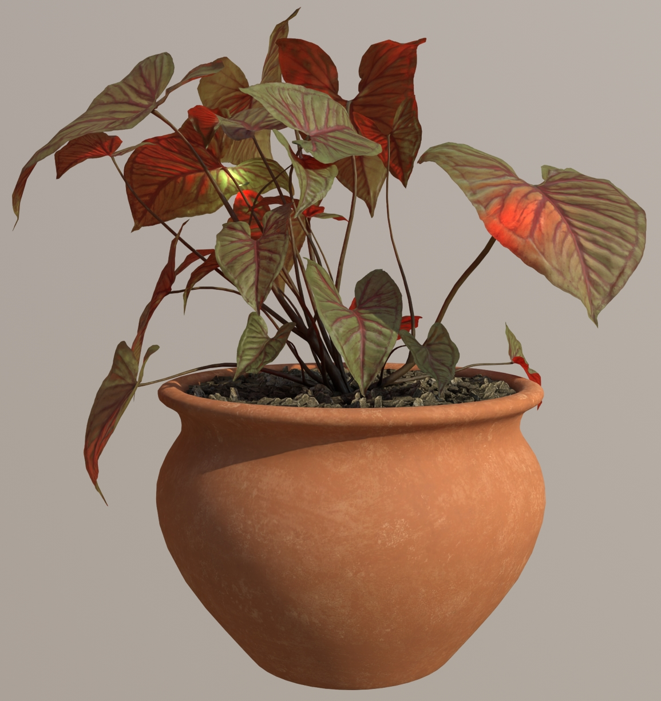
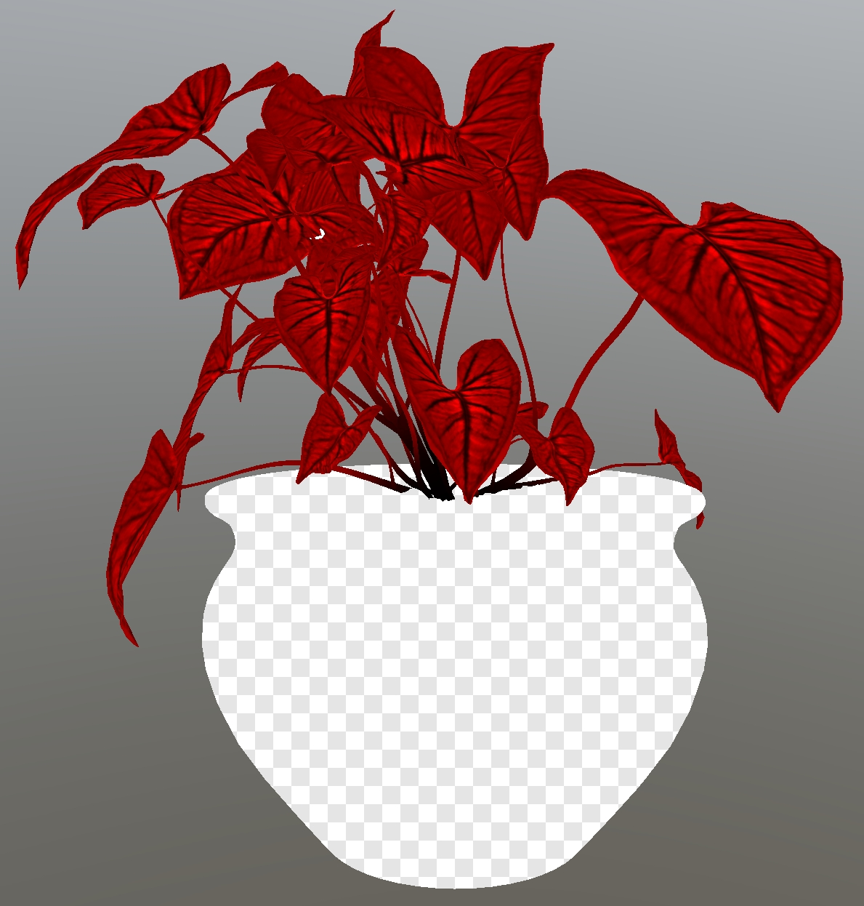

## Screenshot

 _Screenshot from [Vulkan RTX Path Tracer](https://github.com/nvpro-samples/vk_gltf_renderer#vulkan-rtx-path-tracer--gltf-scene-editor--pbr-material-reference)._

## Description

This asset demonstrates the use of [KHR_materials_scatter](https://github.com/KhronosGroup/glTF/tree/main/extensions) to represent thin-surface light transmission of green plant leaves with red backscatter.

The original model is available from [Polyhaven](https://polyhaven.com/a/potted_plant_02). The model was edited with 3ds Max. The leaf textures were edited to show red veins, to help communicate the idea that the leaves are red inside, and thus would show red-colored transmission scattering effects.

Leaf backfaces were removed, and `doubleSided:true` used instead, to allow pathtracers to render this asset effectively. Previously the asset had explicit backfacing triangles with a red material, and was relying on backface culling to render properly, but this is not supported in most pathtracers which makes it impossible to check for ground truth.

The leaves are assigned the scatter extension with a red `multiscatterColorTexture` to control the transmission. The red veins are darker to emphasize the leaf textures, and the bases of the stem trunks are darker to help these parts blend into the rocks better.

 _The multiscatterColorTexture isolated on the model._

Fireflies were added, with emissive textures and point lights, and animated to follow a looping path. 

Point lights were added slightly behind the firefly meshes, instead of inside, because rendering with a pathtracer would cause the firefly bodies to exclude the lights. 

Chase cameras were added behind the fireflies, with a bit of shaky motion to mimic the fireflies ahead of them.

Stem intersections with obvious shading differences were adjusted so their vertices could be welded together.

For optimal texture quality, lossless versions of the textures were re-downloaded from Polyhaven, then the asset was optimized and ambient occlusion for the rocks was baked using vertex color.
