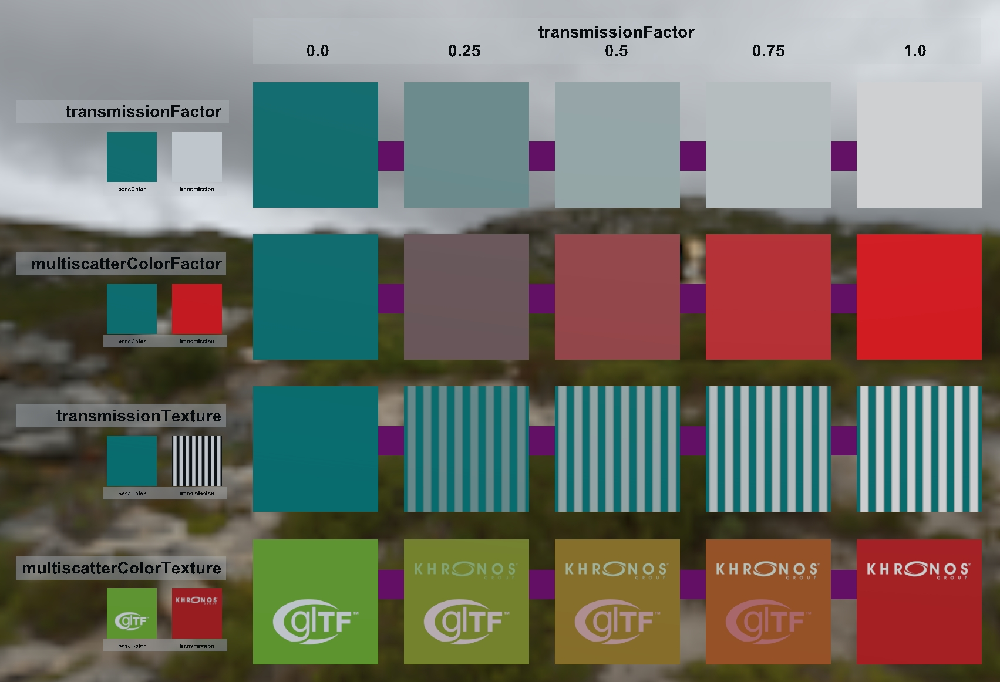
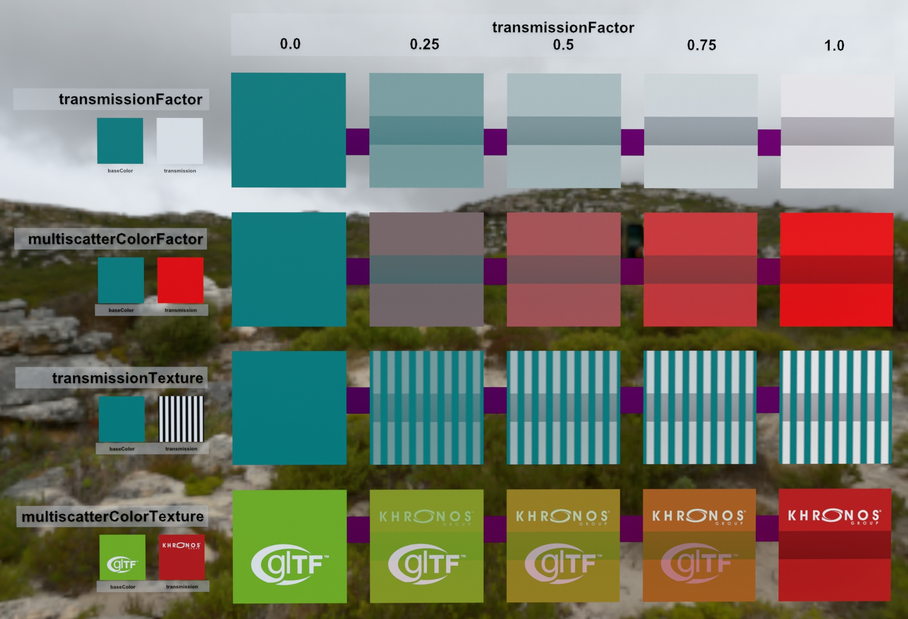

## Screenshot

 
_Screenshot from the [glTF Sample Viewer](https://github.khronos.org/glTF-Sample-Viewer-Release/) with the environment Cannon Exterior._

## Description

This model tests scatter inputs for [`KHR_materials_scatter`](https://github.com/KhronosGroup/glTF/pull/2579).

There is a single directional punctual light, facing the camera.

The smaller rectangles on the left side use Unlit materials to indicate color and texture inputs.

Behind each of the larger rectangles are dark pink rectangles; these may only affect the scattering in renderers using pathtracing.

 
_Path-traced render from the NVIDIA [Vulkan RTX Path Tracer](https://github.com/nvpro-samples/vk_gltf_renderer), using the PBR Neutral tonemapper._
