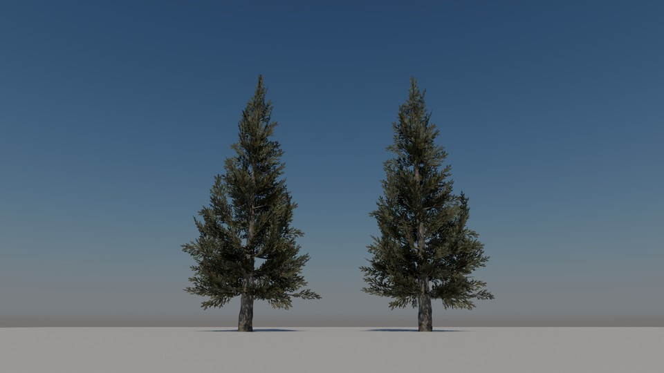
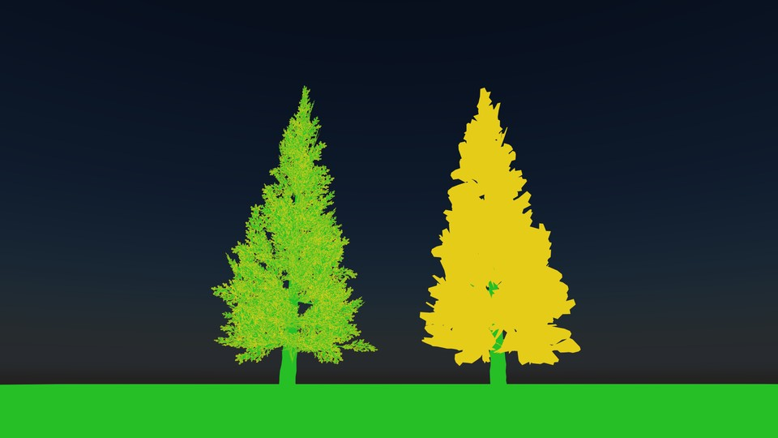

# Spruce Tree with Opacity Micromaps

<!-- This file is auto-generated by modelmetadata. Do not edit by hand. -->

## Tags

[extension](../Models-extension.md)

## Extensions Used

* EXT_mesh_opacity_micromap

## Summary

A spruce tree with alpha-tested foliage demonstrating the EXT_mesh_opacity_micromap extension, which stores ray tracing opacity micromaps baked from the alpha mask.

## Operations

* [Display](https://github.khronos.org/glTF-Sample-Viewer-Release/?model=https://raw.githubusercontent.com/KhronosGroup/glTF-Sample-Assets/main/./Models/SpruceOmm/glTF-Binary/SpruceOmm.glb) in SampleViewer
* [Download GLB](https://raw.githubusercontent.com/KhronosGroup/glTF-Sample-Assets/main/./Models/SpruceOmm/glTF-Binary/SpruceOmm.glb)
* [Model Directory](./)

## Screenshot

(above) Path-traced screenshot from [vk_gltf_renderer](https://github.com/nvpro-samples/vk_gltf_renderer/) showing the spruce with opacity micromaps (left) and without (right).

(above) The same view with the opacity micromap visualization of [vk_gltf_renderer](https://github.com/nvpro-samples/vk_gltf_renderer/). Yellow pixels invoke the any-hit shader; green pixels are resolved as opaque by the ray-tracing hardware without it. With opacity micromaps (left), any-hit invocations remain only along the edges of the needles. Without them (right), every hit on the foliage triangles invokes the any-hit shader. In this view, about 97% of the tree's pixels invoke the any-hit shader without opacity micromaps, and about 31% with them.

## Description

This is a test model for the [EXT_mesh_opacity_micromap](https://github.com/KhronosGroup/glTF/pull/2623) extension. The asset is a spruce tree originally created by [Georgeous](https://sketchfab.com/intice184) on Sketchfab ([original model](https://sketchfab.com/3d-models/spruce-tree-7a5db417827244d98827459bce0cc944), [CC BY 4.0](https://creativecommons.org/licenses/by/4.0/)), adapted to demonstrate the extension.

The scene contains two identical trees placed side by side on a ground plane. The branch primitive of the left tree uses `EXT_mesh_opacity_micromap`, while the right tree is the same geometry and material without the extension. Both trees should render identically; the difference is in ray-tracing performance, not appearance.

## Opacity micromaps

Foliage is usually modeled as a small number of triangles with an alpha-tested texture (`alphaMode` `MASK`). In a ray tracer, every ray that hits such a triangle has to run an any-hit shader to sample the texture and decide whether the hit is accepted, even where the texture is fully opaque or fully transparent. On a tree, most rays touch many of these triangles, so these any-hit invocations dominate the tracing cost.

An *opacity micromap* subdivides each triangle into microtriangles and stores a pre-computed opacity state for each one: transparent, opaque, unknown-transparent or unknown-opaque. Ray-tracing hardware (Vulkan `VK_KHR_opacity_micromap`, DirectX 12 opacity micromaps) uses these states to accept or reject hits directly, and only invokes the any-hit shader for microtriangles marked as unknown, which lie on the alpha edge.

The `EXT_mesh_opacity_micromap` extension stores this micromap data in glTF buffers so that it can be baked once and loaded directly by a renderer, instead of being rebuilt at load time.

## Content of this asset

- The micromap data was baked from the branch material's base color alpha and `alphaCutoff` with [gltf_omm_baker](https://github.com/nvpro-samples/gltf_omm_baker).
- It uses the 4-state format (`usageFormats` of `2`), so microtriangles that straddle the alpha edge are marked as unknown and resolved by the material's alpha test. Rendering with or without the extension therefore gives the same result.
- The branch primitive has 5,602 triangles. They reference 156 distinct micromap triangles through the `micromapIndices` accessor, with subdivision levels 4 to 7.
- The bark primitive and the ground plane are opaque and do not use the extension.

Renderers that do not support the extension, including rasterizers, ignore it and render the material's alpha test as usual.

## Legal

&copy; 2025, Georgeous. [Creative Commons Attribution 4.0 International](https://creativecommons.org/licenses/by/4.0/legalcode)

 - Georgeous for Original model and textures

&copy; 2026, NVIDIA. [Creative Commons Attribution 4.0 International](https://creativecommons.org/licenses/by/4.0/legalcode)

 - Martin-Karl Lefrançois for Opacity micromap data and scene edits

<!-- This file is auto-generated by modelmetadata. Do not edit by hand. -->
